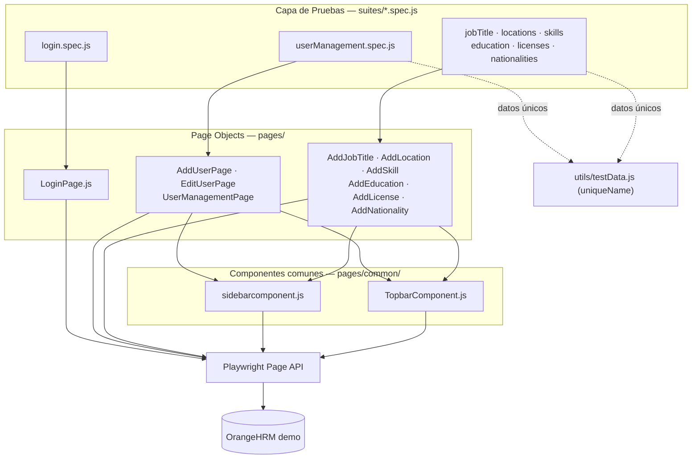

# Framework de Automatización de Pruebas UI — OrangeHRM

Framework de automatización de pruebas end-to-end (E2E) sobre la interfaz de usuario de la aplicación demo pública de **[OrangeHRM](https://opensource-demo.orangehrmlive.com/)**, construido con **Playwright**, patrón **Page Object Model (POM)**, documentación **BDD/Gherkin**, reportería **Allure** y orquestación de CI/CD con **Jenkins**.

> Proyecto open source pensado para servir como plantilla reutilizable de un framework de automatización de pruebas UI, incluyendo pipeline de CI/CD listo para adaptar a otros proyectos.

---

## Tabla de contenido

- [Stack tecnológico y versiones](#stack-tecnológico-y-versiones)
- [Arquitectura del proyecto](#arquitectura-del-proyecto)
- [Estructura de carpetas](#estructura-de-carpetas)
- [Requisitos previos](#requisitos-previos)
- [Instalación](#instalación)
- [Ejecución de pruebas](#ejecución-de-pruebas)
- [Reportería](#reportería)
- [Datos de prueba únicos](#datos-de-prueba-únicos)
- [Documentación BDD y trazabilidad](#documentación-bdd-y-trazabilidad)
- [Pipeline CI/CD (Jenkins)](#pipeline-cicd-jenkins)
- [Alcance y limitaciones conocidas](#alcance-y-limitaciones-conocidas)
- [Cómo contribuir](#cómo-contribuir)
- [Licencia](#licencia)

---

## Stack tecnológico y versiones

Versiones verificadas contra `package.json`, `package-lock.json` y los binarios instalados en `node_modules` al momento de escribir este documento. Se recomienda usar **estas versiones o superiores** salvo que se indique lo contrario.

### Runtime y gestor de paquetes

| Tecnología | Versión usada en este proyecto | Versión mínima recomendada |
|---|---|---|
| [Node.js](https://nodejs.org/) | v24.18.0 | **≥ 20.x LTS** (requerido por `@types/node` y por la instalación `node20` de Jenkins) |
| [npm](https://www.npmjs.com/) | 11.16.0 | ≥ 10.x |

> El proyecto usa ES Modules (`"type": "module"` en `package.json`), por lo que se requiere una versión de Node con soporte estable para `import`/`export` nativos (Node ≥ 18 como mínimo; se recomienda 20 LTS o superior).

### Dependencias de automatización (`package.json`)

| Paquete | Versión | Rol en el proyecto |
|---|---|---|
| [`@playwright/test`](https://playwright.dev/) | **^1.64.0** | Test runner y librería de automatización E2E (motor principal del framework). |
| `playwright-core` | 1.64.0 (resuelto por `@playwright/test`) | Motor de automatización de navegadores usado internamente por Playwright. |
| [`allure-playwright`](https://www.npmjs.com/package/allure-playwright) | **^3.13.0** | Reporter que conecta los resultados de Playwright con Allure. |
| [`allure`](https://www.npmjs.com/package/allure) | **^3.20.1** | CLI de Allure Report (generación/visualización del reporte a partir de `allure-results`). |
| [`gherkin-lite`](https://www.npmjs.com/package/gherkin-lite) | **^1.1.0** | Helpers `feature/scenario/given/when/then` para estructurar los specs en estilo BDD/Gherkin sobre Playwright. |
| [`@types/node`](https://www.npmjs.com/package/@types/node) | **^26.6.5** | Tipado de Node.js para autocompletado/chequeo en editores (dev dependency). |

> Todas las versiones usan rango `^` (compatible con versiones menores/parche superiores). Se recomienda **no bajar** de las versiones exactas listadas arriba para garantizar reproducibilidad; usar `npm ci` (no `npm install`) para instalaciones deterministas basadas en `package-lock.json`.

### Navegadores (motores de Playwright)

Playwright administra sus propios binarios de navegador (no usa el Chrome/Firefox instalado en el sistema). La versión de cada motor queda fijada por la versión de `@playwright/test` (**1.64.0**) instalada:

| Navegador | Estado en `playwright.config.js` | Instalación |
|---|---|---|
| **Chromium** (Desktop Chrome) | ✅ Activo — único proyecto habilitado actualmente | `npx playwright install chromium` |
| **Firefox** (Desktop Firefox) | ⚙️ Configurado pero comentado | `npx playwright install firefox` |
| **WebKit** (Desktop Safari) | ⚙️ Configurado pero comentado | `npx playwright install webkit` |

Para instalar los tres motores (como hace el pipeline Jenkins) y dejar el entorno listo para activar Firefox/WebKit en el futuro:

```bash
npx playwright install chromium firefox webkit
```

> Requisito de versión: usar **siempre** los navegadores que instala `npx playwright install` para la versión de `@playwright/test` del proyecto (1.64.0 o superior) — no apuntar a un Chrome/Firefox/Safari del sistema operativo, ya que Playwright fija versiones exactas de motor por versión de librería para garantizar estabilidad.

### Reportería

| Herramienta | Versión | Notas |
|---|---|---|
| **Allure Report** (CLI `allure` + reporter `allure-playwright`) | `allure` ^3.20.1 / `allure-playwright` ^3.13.0 | Reporte visual enriquecido (pasos, adjuntos, históricos). Resultados crudos en `allure-results/`. |
| **Playwright HTML Reporter** | Incluido en `@playwright/test` 1.64.0 | Reporte nativo en `playwright-report/`, generado en paralelo a Allure sin interferencia. |

### CI/CD e infraestructura

| Herramienta | Versión / Instalación requerida | Rol |
|---|---|---|
| **Jenkins** | Cualquier versión reciente con soporte de Declarative Pipeline | Orquestación del pipeline (`Jenkinsfile`). |
| Jenkins · Plugin **NodeJS** | — | Provee la instalación `node20` declarada en `tools { nodejs 'node20' }`. |
| Jenkins · Plugin **Allure** (+ Allure Commandline en *Manage Jenkins > Tools*) | — | Publica el reporte Allure dentro de la interfaz del build. |
| **Git** | Cualquier versión reciente | Control de versiones y disparo del pipeline (`pollSCM`). |
| **PowerShell** | 5.1+ (Windows) | Shell usado por los steps `powershell` del `Jenkinsfile` (agente Windows). Si el agente es Linux/macOS, estos bloques deben migrarse a `sh`. |

### Otras herramientas de soporte al proyecto

| Herramienta | Uso |
|---|---|
| **Azure DevOps** | Gestión del backlog (épicas, features, HU, tareas) — ver `docs/Backlog-Azure-Framework-Pipeline.md`. |
| **Visual Studio Code** | IDE de referencia usado durante el desarrollo del framework. |
| **Mermaid** | Diagramas de flujo embebidos en `docs/Backlog-Azure-Framework-Pipeline.md` (flujo de ejecución local, flujo del pipeline, arquitectura POM). |

---

## Arquitectura del proyecto

El framework sigue el patrón **Page Object Model (POM)**: las especificaciones de prueba (`suites/`) nunca interactúan directamente con selectores del navegador — delegan en clases Page Object (`pages/`), que a su vez reutilizan componentes comunes de navegación (`sidebar`/`topbar`) y se apoyan en `utils/testData.js` para generar datos únicos.



> Diagramas de flujo adicionales (ejecución local y ejecución del pipeline Jenkins) están disponibles en `docs/Backlog-Azure-Framework-Pipeline.md`.

---

## Estructura de carpetas

```
.
├── pages/                      # Page Objects (POM) — toda interacción con selectores vive aquí
│   ├── admin/
│   │   ├── job/                 # AddJobTitle.js
│   │   ├── nationality/         # AddNationality.js
│   │   ├── organization/        # AddLocation.js
│   │   ├── qualifications/      # AddSkill.js, AddEducation.js, AddLicense.js
│   │   └── user_management/     # AddUserPage.js, EditUserPage.js, UserManagementPage.js
│   ├── common/                  # Componentes compartidos de navegación
│   │   ├── sidebarcomponent.js
│   │   └── TopbarComponent.js
│   └── login/
│       └── LoginPage.js
├── suites/                     # Specs de prueba (*.spec.js) — testDir de playwright.config.js
│   ├── login.spec.js
│   ├── userManagement.spec.js
│   ├── jobTitle.spec.js
│   ├── locations.spec.js
│   ├── skills.spec.js
│   ├── education.spec.js
│   ├── licenses.spec.js
│   └── nationalities.spec.js
├── utils/
│   └── testData.js              # uniqueName(prefix): datos únicos (timestamp + aleatorio)
├── docs/                        # Documentación BDD, plan de pruebas, backlog
│   ├── diseno-casos-prueba/      # HU-*.md por módulo (Historia + Criterios + Gherkin)
│   ├── Plan-de-Pruebas.md        # Plan de pruebas (ISTQB / ISO 25000)
│   ├── Suite-de-Pruebas.md       # Inventario trazable de casos (CP-XX) y métricas de tiempo
│   └── Backlog-Azure-Framework-Pipeline.md
├── Plantillas.md                # Plantilla base para documentar HU en BDD
├── playwright.config.js         # Configuración de Playwright (testDir, reporters, proyectos)
├── Jenkinsfile                  # Pipeline declarativo (Modo Libre / Modo Despliegue)
├── package.json
└── package-lock.json
```

Carpetas generadas en tiempo de ejecución (no versionadas, ver `.gitignore`):

- `allure-results/` — resultados crudos consumidos por Allure.
- `playwright-report/` — reporte HTML nativo de Playwright.
- `test-results/` — trazas, screenshots y videos de fallos/reintentos.
- `node_modules/`

---

## Requisitos previos

- **Node.js ≥ 20.x LTS** (ver [Stack tecnológico](#stack-tecnológico-y-versiones)) y **npm ≥ 10.x**.
- Acceso a internet hacia:
  - `registry.npmjs.org` (instalación de dependencias).
  - `cdn.playwright.dev` (descarga de binarios de navegador).
  - `https://opensource-demo.orangehrmlive.com/` (aplicación bajo prueba — demo pública compartida).
- (Opcional, para el pipeline) **Jenkins** con plugins **NodeJS** y **Allure**, y **Allure Commandline** instalado en *Manage Jenkins > Tools*.

---

## Instalación

```bash
# 1. Clonar el repositorio
git clone <url-del-repositorio>
cd proyecto-automatizacion-pruebas-UI

# 2. Instalar dependencias de forma reproducible
npm ci
# (alternativa si no existe package-lock.json o se desea actualizar): npm install

# 3. Instalar los navegadores de Playwright
npx playwright install chromium firefox webkit
```

---

## Ejecución de pruebas

```bash
# Ejecutar toda la suite (Chromium, en paralelo)
npx playwright test

# Ejecutar un solo archivo de especificación
npx playwright test suites/login.spec.js

# Ejecutar por patrón de texto/tag (ej. casos marcados o nombrados con "login")
npx playwright test --grep "login"

# Ejecutar en modo UI interactivo (muy útil para depurar)
npx playwright test --ui

# Ver el último reporte HTML generado
npx playwright show-report

# Ver el trace de un test fallido
npx playwright show-trace test-results/<nombre-del-test>/trace.zip
```

> Firefox y WebKit están **configurados pero comentados** en `playwright.config.js` — el proyecto activo es únicamente `chromium`. Para habilitarlos, descomentar los bloques `projects` correspondientes.

---

## Reportería

Cada ejecución genera **dos reportes en paralelo**, sin que interfieran entre sí:

1. **Reporte HTML nativo de Playwright** → `playwright-report/index.html`
   ```bash
   npx playwright show-report
   ```
2. **Allure Report** → resultados crudos en `allure-results/`
   ```bash
   # Generar y servir el reporte Allure localmente (usa la CLI `allure` del proyecto)
   npx allure generate allure-results --clean -o allure-report
   npx allure open allure-report
   # o, en un solo paso:
   npx allure serve allure-results
   ```

En el pipeline Jenkins, el reporte Allure se publica automáticamente en el menú lateral del build (`post > always`), y `playwright-report/**` + `test-results/**` quedan archivados como artefactos descargables.

---

## Datos de prueba únicos

Los módulos de catálogo (Job Title, Location, Skill, Education, License, Nationality) y de usuarios no permiten registros duplicados. Para poder re-ejecutar la suite repetidamente contra el mismo entorno demo compartido sin colisiones, se usa la utilidad centralizada:

```js
// utils/testData.js
export function uniqueName(prefix = 'Auto') {
  const seed = `${Date.now().toString().slice(-8)}${Math.floor(Math.random() * 90 + 10)}`;
  return `${prefix}_${seed}`;
}
```

Todos los specs que crean registros la invocan en lugar de reimplementar lógica de generación de datos, lo que mantiene una tasa de incidentes de colisión del 0% documentada en `docs/Plan-de-Pruebas.md`.

---

## Documentación BDD y trazabilidad

- **Historias de Usuario en formato BDD**: `docs/diseno-casos-prueba/HU-*.md` — una por módulo (Login, UserManagement, JobTitle, Locations, Skills, Education, Licenses, Nationalities), con Historia de Usuario, Criterios de Aceptación (Dado/Cuando/Entonces) y Diseño de Casos de Prueba en Gherkin (Given/When/Then + tags + notas).
- **Inventario trazable de casos**: `docs/Suite-de-Pruebas.md` — tabla con código `CP-XX`, módulo, caso de prueba, tiempo automatizado medido y tiempo manual estimado equivalente (20 casos documentados en total).
- **Plan de Pruebas**: `docs/Plan-de-Pruebas.md` — alcance, estrategia, modelo de calidad aplicado (ISO/IEC 25010 / SQuaRE), criterios de entrada/salida, riesgos y métricas del proyecto.
- **Plantilla reutilizable**: `Plantillas.md` — estructura base para documentar nuevas HU siguiendo el mismo estándar.

En código, los specs usan `gherkin-lite` para expresar el mismo vocabulario Given/When/Then directamente sobre `@playwright/test`:

```js
import { feature, scenario, given, when, then } from 'gherkin-lite';

feature('Autenticación en OrangeHRM', () => {
  scenario('[CP-01] Inicio de sesión exitoso con credenciales válidas', async ({ page }) => {
    await given('el usuario está en la página de login', async () => { /* ... */ });
    await when('ingresa credenciales válidas', async () => { /* ... */ });
    await then('el sistema redirige al dashboard principal', async () => { /* ... */ });
  });
});
```

---

## Pipeline CI/CD (Jenkins)

El `Jenkinsfile` es una **plantilla genérica reutilizable** (Playwright + Allure) pensada para copiarse a otros proyectos. Las secciones marcadas con 🔧 al inicio del archivo son los únicos puntos que deben adaptarse (nombre de instalación Node, ambientes, módulos, credenciales, URL base por defecto).

**Comportamiento por rama:**

| Rama | Modo permitido |
|---|---|
| `develop` (`FREE_MODE_BRANCH`) | **Modo Libre**: ejecución manual por formulario de parámetros + detección automática de cambios por push. También permite probar el Modo Despliegue manualmente. |
| `main` (`DEPLOY_ONLY_BRANCH`) | **Solo Modo Despliegue**. Sin `ENVIRONMENTS` + `MODULES`, el build se marca `NOT_BUILT` y no ejecuta nada. |

**Requisitos en Jenkins:**

- Plugin **NodeJS** con una instalación llamada igual que `NODE_TOOL_NAME` (`node20` por defecto).
- Plugin **Allure** de Jenkins + **Allure Commandline** (en *Manage Jenkins > Tools*).
- Agente **Windows** (los steps usan `powershell`); para agentes Linux/macOS hay que migrar esos bloques a `sh`.
- Sin webhook público, usa `pollSCM('H/5 * * * *')`; si se expone Jenkins con URL pública, reemplazar por `githubPush()`.

**Etapas principales del pipeline**: limpieza de workspace → checkout → información del build → control de rama → validación de parámetros (Modo Despliegue) o detección de cambios (Modo Libre) → instalación de dependencias (`npm ci`) → instalación de navegadores → ejecución de pruebas → publicación de reporte Allure + archivado de artefactos.

Ver flujo completo en formato diagrama en `docs/Backlog-Azure-Framework-Pipeline.md`.

---

## Alcance y limitaciones conocidas

Documentado con mayor detalle en `docs/Plan-de-Pruebas.md`:

- Pruebas de **sistema E2E vía UI** únicamente — sin pruebas de API/backend, carga/estrés, seguridad ni responsive/mobile.
- Navegador activo: **solo Chromium** (Firefox/WebKit configurados pero no ejecutados por defecto).
- Entorno bajo prueba: **demo público de OrangeHRM**, compartido con otros usuarios — de ahí la necesidad de `uniqueName()` para datos.
- Módulos cubiertos: Login, User Management (CRUD), Job Titles, Locations, Skills, Education, Licenses, Nationalities (8 módulos / 20 casos trazables).
- Módulos de OrangeHRM **no** cubiertos: Leave, Time, Recruitment, Performance, entre otros.

---

## Cómo contribuir

1. Crear una rama a partir de `develop`.
2. Si agregas un nuevo módulo: documentar su HU en `docs/diseno-casos-prueba/HU-<Modulo>.md` siguiendo `Plantillas.md`, crear su Page Object en `pages/`, su spec en `suites/` y registrar sus casos (`CP-XX`) en `docs/Suite-de-Pruebas.md`.
3. Verificar localmente con `npx playwright test` y revisar el reporte Allure/HTML antes de abrir el Pull Request.
4. Evitar selectores hardcodeados dentro de `suites/*.spec.js` — toda interacción con la UI debe pasar por un Page Object.

---

## Licencia

ISC — ver el campo `license` en `package.json`.
